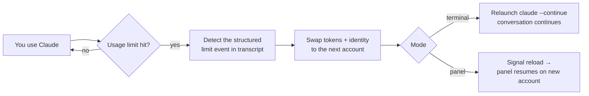

<div align="center">

# 🔄 AGECS Switcher

**Never stop working when Claude hits a usage limit.**

Automatically switch between your Claude subscription accounts the moment one hits its
5-hour or weekly limit — in the terminal *or* the VS Code sidebar — and keep going.


</div>

---

## What it does

You use **Claude Code** exactly as you normally do. When your active account hits a
usage limit, AGECS Switcher detects it, **swaps your login to another account you've
signed into**, and continues your work — no API key, no subscriptions juggling, no
manual re-login.

- ✅ **Two modes** — fully automatic in the terminal, or in the VS Code sidebar panel.
- ✅ **No API key** — it swaps your real subscription logins, not tokens you pay per-use.
- ✅ **Zero dependencies** — pure Node.js, nothing to `npm install`.
- ✅ **Same-org safe** — tells apart two accounts (seats) in the same team/org.
- ✅ **Never false-switches** — keys on Claude Code's structured error flag, not the
  word "limit" appearing in your chat.
- ✅ **Secrets stay local** — logins live in `~/.agecs-switcher/`, never in the repo.

---

## Requirements

| | |
|---|---|
| **Node.js** | v18 or newer — <https://nodejs.org> |
| **Claude Code** | installed and working (`claude` on your PATH) |
| **Accounts** | **two different** Claude logins (two separate subscriptions, or two seats in one team) |
| **OS** | Windows for the one-click `.cmd` helpers; the core CLI is cross-platform |

---

## Quick start

```text
1. Download this repo  (Code ▸ Download ZIP, or git clone) and unzip it.
2. Double-click  setup.cmd                      ← installs the panel helper, checks setup
3. Save your two accounts:
      node agecs.mjs login claude-1             ← type /login, sign in, exit
      node agecs.mjs login claude-2             ← sign in with your OTHER account
4. Double-click  START.cmd  and press a number  ← pick a mode
```

That's it. `node agecs.mjs doctor` confirms both accounts are saved and distinct.

---

## Modes

Double-click **`START.cmd`** and press a key, or run the command directly:

| # | Mode | Command | Switching | Keeps conversation |
|---|------|---------|-----------|--------------------|
| **1** | **Sidebar panel** | `node agecs.mjs watch` | auto (reloads panel) | yes¹ |
| **2** | **Terminal** | `node agecs.mjs run` | **fully auto** | yes (`--continue`) |
| **3** | **App window** | `node app.mjs` / `AGECS.cmd` | manual buttons | — |
| **4** | **Check accounts** | `node agecs.mjs doctor` | — | — |

> ¹ The sidebar needs a one-time setup (two settings + reopen VS Code) — see
> [VS Code sidebar panel](#vs-code-sidebar-panel). The **terminal** mode needs none
> and is the simplest fully-automatic option.

---

## Commands

| Command | What it does |
|---|---|
| `agecs run [provider]` | Launch Claude in the terminal; auto-switch + `--continue` on a limit. |
| `agecs watch [provider]` | For the VS Code **panel**: switch the account on a limit. |
| `agecs login <name>` | Sign a new account in and save it (also records its email). |
| `agecs capture <name>` | Save whoever is logged in right now as `<name>`. |
| `agecs use <name>` | Switch the active account now. |
| `agecs status [provider]` | List accounts: email · saved · ACTIVE · capped. |
| `agecs doctor` | Check accounts are saved, **distinct**, and switchable. |

Pass Claude flags through after `--`:  `node agecs.mjs run claude -- --model opus`

---

## How it works

Claude Code stores your login as two plain files — the **tokens** in
`~/.claude/.credentials.json` and the **account identity** (`oauthAccount`: email,
`accountUuid`, org) in `~/.claude.json` — and logs every API error, including usage
limits, to its session transcript as a structured `isApiErrorMessage` event.



1. **Vault** — each account's login snapshot is saved under `~/.agecs-switcher/vault/`.
2. **Detect** — the watcher tails the live transcript for a *real* limit event (the
   structured flag, so normal chat mentioning "limit" never triggers it).
3. **Switch** — it copies the next account's snapshot over the live files, swapping
   **both** tokens and identity (so two seats in the same org are kept distinct).
4. **Continue** — terminal relaunches `claude --continue`; the panel reloads so it
   re-reads the new login.

---

## VS Code sidebar panel

The panel caches its login in memory, so swapping files alone won't move a *running*
chat. The included **AGECS Reloader** companion extension fixes that: the switcher
signals it on a swap, and it reloads the window so the panel re-reads the new login.

**One-time setup** (done for you by `setup.cmd`, plus two settings):

1. Install the helper — double-click **`install-reloader.cmd`** (or it's part of `setup.cmd`).
2. Set **`claudeCode.continueAfterReload: true`** in VS Code settings — resumes your
   conversation after the reload.
3. Set **`autoContinueAtUsageLimit: true`** in `~/.claude/settings.json` — Claude Code
   then continues the interrupted task automatically.
4. Fully **quit and reopen VS Code once** to load the helper and settings.

After that: a limit → `watch` swaps the account → the window reloads → your
conversation resumes on the new account.

> **Why both tokens and identity?** The panel reads the displayed account from
> `~/.claude.json` (`oauthAccount`), not just the token file. `use` / `watch` swap
> both automatically — but only for accounts saved **with** their identity, so run
> `agecs login <name>` once per account (not just `capture`).

---

## Configuration

`accounts.json` (safe to edit — no secrets):

```jsonc
{
  "activeDirs":   { "claude": "~/.claude", "codex": "~/.codex" },
  "vaultDir":     "~/.agecs-switcher/vault",
  "transcriptsDir": "~/.claude/projects",
  "defaultCooldownHours": 5,
  "providers": {
    "claude": {
      "cmd": "claude",
      "credFile": ".credentials.json",
      "identityField": "organizationUuid",
      "continueArgs": ["--continue"],
      "accounts": ["claude-1", "claude-2"]
    }
  },
  "limitPatterns": ["5-hour limit", "weekly limit", "usage limit", "limit reached", "rate limit"]
}
```

Add more account slots by name (`claude-3`, …) and `agecs login` each one. If a future
Claude Code version changes the limit wording, add the new phrase to `limitPatterns`.

---

## Testing

```bash
npm test        # node --test
```

**54 tests, zero dependencies**, all on fake data: limit detection (incl. the
no-false-switch guard), the per-poll transcript scan (launch-time filter, cross-poll
dedup, reset-epoch parsing), the live tailer, 3-account rotation + cooldown, vault
capture/activate round-trip, re-capture, corrupted/missing credential files,
**same-org two-account** distinction, email recording, duplicate detection, the local
server connection, and the full fake-transcript → account-swap flow.

---

## Troubleshooting

| Symptom | Fix |
|---|---|
| `no saved accounts` | Run `agecs login claude-1` (and `claude-2`) first. |
| `only 1 distinct account` (doctor) | You saved the same login twice — re-`login` the second slot with a *different* account. |
| Panel still shows the old account | Fully **quit and reopen** VS Code (not *Reload Window*); confirm the two settings above. |
| `spawn EINVAL` on Windows | Use the provided scripts / `node agecs.mjs …`; they route through `cmd.exe` for you. |
| Nothing switches | The watcher must be **running** (`watch` / `run`), and a *real* limit must be hit. |

---

## Caveats

- **Terms of service.** Rotating accounts to get past usage limits is a gray area for
  Anthropic even with your own paid accounts. Use at your own discretion.
- **One manual step.** Signing each account in once (OAuth) can't be automated — it
  needs a browser and your credentials. Everything after that is automatic.
- **Codex / ChatGPT** is wired in config but unverified (the OpenAI Codex CLI wasn't
  available during development) — confirm its `auth.json` path before relying on it.

---

## License

MIT.
